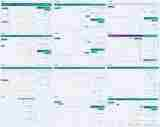
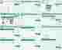
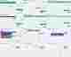
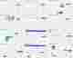
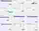
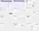
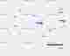

# التطبيق المرجعي — معرض الصور والوظائف

**المصدر:** أرشيف الصور الذي قدمه مالك متجر الأغبري. **عدد الصور الأصلية:** 84. **المعرض الدائم:** سبع لوحات معاينة تغطي الصور كلها. **التاريخ الظاهر في معظم اللقطات:** 6 أغسطس 2026.

## المعرض

## كيفية استخدام الصور
- P1: مرجع RTL وترتيب المعلومات والتنقل والتصميم المتجاوب وحالات UX.
- P2: مرجع الوظائف التي تحتاج عقود بيانات وصلاحيات وتكامل، لا دليل صحة backend.
- P3: مرجع مركز السيولة والقرارات والتقارير والذكاء والتشغيل ومراقبة النظام.
- افتح المعرض من GitHub في كل جلسة جديدة أو عند استلام task مرجعي. لا تعِد فك الأرشيف ولا تطلب من المالك إعادة إرساله.
- هذه اللوحات معاينات مرئية، وليست لقطات أصلية عالية الدقة لكل تفصيل. لا تخمّن نصاً غير مقروء؛ اعتمد على ما هو واضح وعلى المواصفة/الكود.
- لا تنسخ اسم/هوية التطبيق الآخر، ولا تنسخ الأرقام أو أسماء العملاء/البيانات المالية من الصور إلى fixtures أو قاعدة البيانات.
- بعض الصور تعرض أخطاء JavaScript وصفحات فارغة أو أخطاء تحميل بجانب واجهات ناجحة ظاهرياً؛ لا تنسخ الأخطاء ولا تعتبر الصورة إثباتاً لوظيفة مكتملة.
- المصفوفة المركزية هي tracker الوحيد. لا تحول هذا المعرض إلى tracker موازٍ.
- الصورة مرجع تصميمي ووظيفي فقط. لا تغلق متطلباً لأن لقطة شاشة أظهرته؛ يلزم تنفيذ/مصدر بيانات/صلاحية/اختبار ودليل exact-SHA.

المتطلبات الجديدة المستوحاة من المعرض موثقة في القسم 23 من المواصفة الأصلية وموجودة في الصفوف REF-* بالمصفوفة المركزية.
